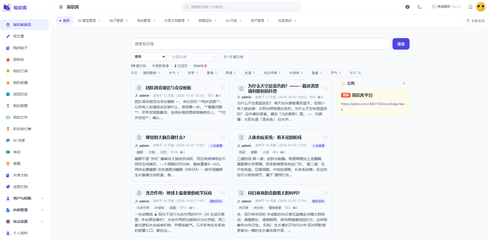
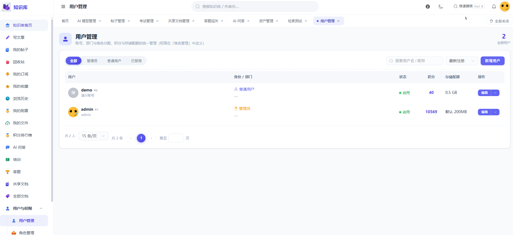
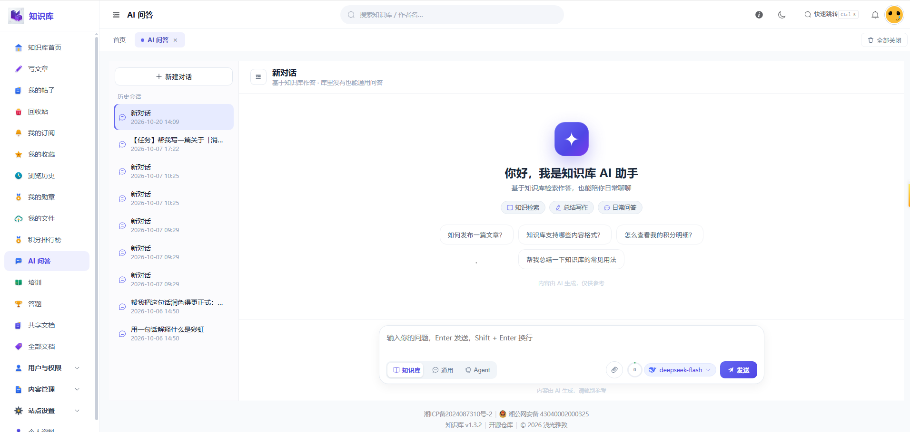

# 知识库平台

<div align="center">

**一站式企业知识枢纽 · 文档协同 · 培训考核 · AI 问答**

[](#开源许可与商业授权)
[](https://openjdk.org)
[](https://spring.io/projects/spring-boot)
[](https://vuejs.org)
[](https://www.postgresql.org)
[](https://www.electronjs.org)

</div>

---

## 还在用群文件管知识？团队协作的时代困局

文档以 Word、Excel、PDF、思维导图、网页收藏的形态散落在微信群、网盘和每个人的电脑里——
真正重要的经验，却总是在最需要的时候找不到。

- **散**：资料散落在十几个群聊和网盘里，找一份文档要翻三处、问两人？
- **乱**：「最终版_v3_改_真最终.docx」满天飞，哪版是准的、谁改了什么，没人说得清？
- **难**：搜索形同虚设，标题对不上、正文搜不到，知识明明就在库里却「查无此文」？
- **慢**：协作靠「发文件 → 改完 → 传回来」来回传版本，新人上手全靠口口相传？
- **失**：老员工一离职经验就断档——沉淀不下来的知识，等于从来没有过。

割裂的文件传输和静态网盘，已经成为团队吸收、协作与传承知识的枷锁。
**你需要一个统一、安全、会思考的知识枢纽**：把任何形态的知识，变成可检索、可协同、可传承的「活资产」。

## 知识库平台：团队的统一知识枢纽

**文档 · 实时协同 · 培训考核 · AI 问答，一个平台全部搞定。**

**核心优势 1：一个编辑器，装下所有知识形态！**
富文本 / 思维导图 / 流程图 / 电子表格——整篇专属文档或文内嵌入皆可；基于 Tiptap + Yjs 的实时协同，
多人同编、光标可见、离线恢复，编辑锁杜绝互相覆盖。

**核心优势 2：AI 问答，答案有据可查！**
RAG 检索增强——先检索知识库、核对可见性、再注入模型上下文，回答附带引用来源与思考过程；
OpenAI 兼容三件套（端点 / Key / 模型名），DeepSeek、GLM、GPT、通义随意切换，管理页填 Key 即用、即时生效。

**核心优势 3：毫秒级全文检索！**
Meilisearch 毫秒级检索 + 数据库逐词兜底降级，检索结果与文档可见性双向核对——该看到的秒出，不该看到的一条不漏。

**核心优势 4：企业级管控开箱即用！**
细粒度权限码、操作审计与登录告警、滑动拼图验证码、全局水印、功能开关——纯内网部署也安全。

**核心优势 5：不止是文档库！**
题库与在线考试、课程学习与证书、资产借还、积分徽章排行榜、实时通知中心，培训考核一站式闭环。

**核心优势 6：三端覆盖！**
Web 全功能 + Electron 桌面客户端 + Capacitor Android + **Kotlin 原生壳**（Jetpack Compose，`mobile/mobile-native`），内网 / 公网 HTTPS 部署模板齐备。

---

## 在线演示

公网演示环境：**https://你的域名**

| 账号 | 密码 | 说明 |
|---|---|---|
| `demo` | `demo114514` | 演示账号：可浏览全部内容与后台只读页（文件/审计/登录日志/检索测试），写操作受演示模式拦截 |

> 演示数据定期重置，请勿存放真实资料；需要完整权限可部署私有实例（见下方快速开始）。

---

## 界面预览

<div align="center">

| | |
|---|---|
|  |  |
| *知识库首页* | *用户与权限管理* |
|  | |
| *AI 问答（RAG）* | |

</div>

---

## 功能一览

### 文档与知识
- **文章 / 文档**：CRUD、分类标签、附件、回收站、版本历史、DOCX 导入、导出
- **全文搜索**：Meilisearch 毫秒级检索 + MySQL LIKE 自动降级，索引与数据库可见性双向核对
- **实时协同编辑**：Tiptap + Yjs + Hocuspocus，多人同编、离线恢复；文档内嵌思维导图（mind-elixir，协同编辑锁）
- **共享文档**：文档级细粒度权限（可读 / 可编 / 可管理）、团队空间、扩容审批
- **待整理箱**：分享 / 扫描 / 速记先「收进来」，之后集中补标题、选空间归档；文档库入口带未整理数角标
- **标签与筛选**：文档多标签（跨空间统一）、按标签 / 空间 / 类型 / 时间筛选；「全部文档」支持正文检索、批量打标签
- **批注摘录**：划词保存摘录 + 笔记（不改原文），笔记页可搜索、可跳回原文
- **双向链接与提及**：正文 `[[文档名]]` 建立双向链接；`@用户` 触发站内通知（SSE 实时）
- **复习卡片**：摘录 / 选中文字一键生成卡片，SM-2 间隔重复复习；学习计划带进度与复习提醒、首页每日回顾
- **采集**：网页剪藏（抓正文 → 预览 → 存文档）、系统分享导入（含 zip 自动解压）、整库导出（zip）
- **桌面命令面板**：Ctrl / ⌘ + K 快速跳转页面、搜索文档、执行常用动作

### 社区与互动
- 评论（敏感词过滤 + 词边界匹配）、点赞收藏订阅、积分、徽章穿戴、排行榜、签到
- 个人主页 / 用户主页（自定义背景横幅）、通知中心（SSE 实时推送）、公告栏

### 培训考核
- 题库 + 在线考试（防泄题、并发提交约束）、课程学习、章节评论、证书
- **AI 出题**：按知识库文档 / 指定网页 / 通用知识生成题目，预览勾选后批量入库（也接入了 AI 问答的 Agent）
- **组卷与批量管理**：按分类筛选题库、一键组卷、题目/试卷批量删除；组卷可自定义总分与及格分（按题数平均分配）
- **双模式答题**：考试模式（限时计分、交卷出成绩）与练习模式（答一题立即判分看解析、不计成绩）；「模拟练习」可由管理员指定一份固定模拟卷，未指定时从题库随机抽题
- **练习增强**：答题卡（对/错/主观/未答）自由跳题、本轮正确率与错题回顾；练习流水落库，自动生成**错题本**（答对自动移出，也可手动标「已掌握」）

### 知识组织与对外
- **知识图谱**：`[[文档标题]]` 建立的双向链接渲染成全站关系图（节点按度数缩放、可搜索、点击跳转）
- **文档外部分享**：一键生成免登录只读链接，可设密码 / 有效期 / 禁止复制 / 访问者水印，并统计访问次数
- **文档模板**：会议纪要 / 周报 / 需求等模板，新建文档时一键套用；管理员可把现有文档「存为模板」
- **版本对比**：版本历史支持与当前内容做段落级 diff（新增绿 / 删除红）
- **附件在线预览**：PDF / Word / Excel / 图片 / 文本直接在文件中心预览，无需下载（>40MB 或 pptx 引导下载）
- **收藏分组**：收藏可分组，按分组筛选
- **题库 Excel 批量导入**：按模板列批量导入单选/多选/判断/填空/简答，逐行报错
- **通知外发**：企业微信 / 钉钉（加签）/ 自定义 Webhook，管理端可发测试消息

### 管理后台
- 用户 / 角色 / 权限码 / 部门管理，细粒度权限码集中管理（`Perm` 白名单）
- 审核中心、资产管理（借用归还 / Excel 导出）、数据看板、审计与登录日志、公告管理
- **系统外观**：站点 Logo / 资料页背景图自定义，登录页二维码、全局水印、功能开关（维护页 / 隐藏双模式）
- **偏好设置**：导航位置（侧边 / 双列 / 顶部）、侧边栏显隐与深色、内容宽度、密度、强调色、主题跟随系统、起始页；菜单支持拖拽排序（分组内子菜单也可拖），偏好存本机 `localStorage`

### AI 问答
- 标准 OpenAI 协议接入（管理页自定义端点 / Key / 模型名，DeepSeek、GLM、GPT、通义、OpenCode、小米 MiMo 等皆可）+ RAG 检索增强：Meili 命中 → 数据库可见性核对 → 注入模型上下文
- **多模型管理**：管理员在后台自行添加 / 启停 / 设默认；API Key AES-GCM 加密落库、列表只回显脱敏值，**仓库零密钥**；未配置时 AI 模块自动降级，其余功能不受影响；对话页模型选择器带供应商品牌图标
- **流式回答（SSE）**：`POST /api/ai/ask/stream` 逐段下发，前端逐字渲染，首字即显示；沿用多模型降级链与「停止生成」；旧客户端自动回退一次性接口
- **Agent 模式**：内置工具循环，AI 可自主检索知识库、读写文档、生成流程图、跳转页面、向用户反问确认、**AI 出题入题库**；执行步骤逐条展示、可随时停止
- **上下文治理**：分段 token 用量、长对话自动压缩、步骤留存复盘、拦截模型复述提示词
- OCR 图片识别可在「AI 模型管理」里勾选「用于图片 OCR」指定视觉模型（不勾时沿用智谱条目），无独立密钥配置

### 安全
- 滑动拼图验证码（服务端基准 + 容差 + 轨迹检测 + IP 限流）、HMAC-SHA256 自签令牌、salt+SHA-256 密码
- 管理员脚本登录实时告警（SSE 通知）、细粒度管理接口鉴权（过滤器 + 控制器双层）、安全响应头、路径穿越防护

---

## 差异化：学习闭环（错题 → 文档 → 复习卡）

通用知识库止步于「存文档 + 考试打分」，本平台把**考试数据**和**文档内容**连起来，回答一个别人答不了的问题：
**这段文档是不是没讲清楚？**

- **错题 → 文档**：按题干/分类/解析抽关键词，在**你本人可读的文档范围内**定位对应章节，
  返回标题 + 命中片段（可解释，不是黑盒相似度）
- **错题 → 复习卡**：一键把错题变成卡片（正面题干、背面答案+解析），并记住关联文档，复习时能跳回原文；
  同一题重复加入不会重复建卡
- **文档 → 易错点**：给定文档，统计关联题目的全站作答次数与错误率，附样例题 —— 给作者看「哪里没写清楚」

匹配策略刻意做成**可解释的轻量启发式**（关键词 + 绝对分门槛），而不是向量检索：
错题量级（几十~几百）用不上向量库，而且用户看到「因为命中『索引失效』所以推荐《数据库索引》」能理解，
相似度分数解释不了。实测：正例全部命中正确文档，无关题目返回空（不乱推荐）。

## 技术栈

<div align="center">

<a href="https://skillicons.dev">
  
</a>

</div>

| 层 | 技术 |
|---|---|
| 前端 | Vue 3（`<script setup>`）· Vite · Pinia · Vue Router · Element Plus（按需引入）· wangEditor / Tiptap |
| 后端 | Spring Boot 4（Java 21）模块化单体 · Spring Data JPA · **PostgreSQL 18**（兼容 MySQL 8，双驱动） |
| 实时协同 | Tiptap + Yjs · Hocuspocus 中继（`collab-relay/`，Node + pg，与后端共用 PostgreSQL） |
| 搜索 | Meilisearch（可选，`docker-compose.yml`）· MySQL LIKE 降级兜底 |
| AI | 标准 OpenAI 协议（`/chat/completions`）+ 自定义模型配置，RAG 检索增强 |
| 桌面端 | Electron 33：纯 Node 本地托管 + 反代后端，零框架改动套壳 |
| 移动端 | Capacitor 8（Android），远端模式直连内网后端 |
| 工程与质量 | HikariCP 连接池 · Hibernate 7 · Logback 滚动日志（ERROR 分离）· ESLint 9（前端）· Checkstyle + SpotBugs（后端） |
| 部署 | `deploy/`：env.prod / env.test + nginx 模板，HTTPS + 静态预压缩（.gz / .br） |

## 目录结构

```
knowledge-base/
├── backend/                  # Spring Boot 后端（com.kb.kbplatform）
│   └── src/main/java/com/kb/kbplatform/
│       ├── bootstrap/        # DataInitializer：启动种子（测试账号 + 示例文档）
│       ├── collab/           # 协同编辑后端支持
│       ├── config/           # 应用配置
│       ├── domain/           # JPA 实体（Document / User / Exam / Asset / Badge…）
│       ├── repository/       # Spring Data JPA 仓储
│       ├── security/         # AuthFilter / TokenClaims / TokenUtil / Perm 权限码集中管理
│       ├── service/          # 业务服务（文档/搜索/AI RAG/资产/考试/评论/水印/外观…）
│       └── web/              # REST 控制器（含 admin/* 管理接口）
├── frontend/                 # Vue 3 前端（30+ 页面，1024/640 双断点响应式）
│   └── src/
│       ├── views/            # Home / Login / AiChat / DocShare* / Exam* / Course* / admin/*
│       ├── components/       # SlideCaptcha / RichEditor / CommentSection / WornBadgeStrip…
│       ├── utils/            # time / text / appearance(外观共享缓存) / theme / level…
│       ├── responsive.css    # 响应式基础设施（表格卡片化、浮层限宽、表单标签置顶）
│       └── store/ api/
├── collab-relay/             # Hocuspocus 协同中继（Node）：verifyToken 校验 + Yjs 快照持久化到 PostgreSQL
├── desktop/                  # Electron 桌面客户端（build-web.js 复用前端构建）
├── mobile/
│   ├── android/              # Capacitor 8 Android 工程（sync-web.js 同步前端产物）
│   └── mobile-native/        # Kotlin 原生壳（Compose + WebView 混合，独立 Gradle 工程，不含 node_modules）
├── deploy/                   # 生产/测试部署：env.prod、env.test、nginx-example.conf
├── db/                       # init.sql + v113~v123 增量 SQL（并发约束/回收站/版本/禁词库等）
├── docker-compose.yml        # 可选基础设施（Meilisearch 等，默认不启动）
└── pom.xml                   # Maven 聚合工程
```

## 登录方式

- **本地账号**：用户名 + 密码（含滑块验证码）
- **LDAP / AD**：服务账号搜用户 DN → 用户 DN+密码 bind 校验；配置入口「管理 → 企业登录」
- **OIDC / 单点登录**：标准授权码流程，兼容 Keycloak / Azure AD / 企业微信 / 钉钉 / 飞书（回调地址见配置页）
- **GitHub / Gitee 登录**：GitHub App 或 Gitee 第三方应用，配置 App ID + Client secret 即启用
- **微信 / QQ 扫码登录**：走各自开放平台授权码流程，后台未配置时登录页不显示对应图标

> 所有第三方登录都复用同一套会话签发（`AuthService.loginExternal`）：首次登录自动建号（角色 USER），
> 已存在账号只同步昵称/邮箱/头像，不会覆盖角色与密码。配置入口统一在「管理 → 企业登录」。

## 快速开始（本地开发）

### 1. 数据库（唯一前置依赖）

PostgreSQL 18（推荐，MIT 协议可自由分发），默认连接 `jdbc:postgresql://localhost:5432/kb`（账号 `kb/kb`）。

**首次安装 PG 后执行一次初始化**（用 pgAdmin 或 psql 均可）：

```sql
CREATE USER kb WITH PASSWORD 'kb';
CREATE DATABASE kb OWNER kb;
```

业务表由 JPA（`ddl-auto: update`）**自动创建，无需手动导表**——`update` 模式「只增不删不改」：已有表不重建、已有数据不覆盖，新版加字段时仅自动补列，升级安全。
`db/*.sql` 为结构约束与数据迁移增量脚本；内置测试账号与示例文档仅在**库为空时**自动插入，已有数据不受影响。
连接信息在 [`backend/src/main/resources/application.yml`](backend/src/main/resources/application.yml) 的 `spring.datasource` 段（约第 15~18 行），改完保存重启后端即可。
切回 MySQL：同文件里注释掉 PostgreSQL 四行、启用文件末尾的 MySQL 数据源配置（双驱动均已引入）。

### 2. 启动后端

IDEA 打开根目录（自动识别 Maven 聚合工程），运行预置配置 `Backend (Maven spring-boot:run)`（`:8080`），或：

```bash
cd backend && mvn spring-boot:run
```

**启用 AI 问答**（可选，不配置不影响其他功能）——**无需改配置文件、无需环境变量**，登录管理员后在「内容管理 → AI 模型管理」页添加模型即可，保存后即时生效、无需重启。

配置本质是 **OpenAI 兼容三件套**：`base-url`（端点）、`api-key`（密钥）、`model`（模型名）。任何 OpenAI 兼容服务都可用（智谱 / DeepSeek / 通义 / OpenAI / 本地 vLLM 网关等），添加时选择平台会自动填充端点与推荐模型版本。

| 步骤 | 操作 |
|---|---|
| ① 登录管理员 | 用 `admin` 账号登录，进入「内容管理 → AI 模型管理」 |
| ② 添加模型 | 选平台 → 端点自动填充 → 填 API Key → 选模型版本 → 保存 |
| ③ 测试连接 | 点该条目的「测试连接」确认可用；可设为「默认模型」供对话页未选择时使用 |
| ④ 开始使用 | 普通用户在 AI 问答页选模型提问，回答下方会显示实际模型名 / 耗时 / token 用量 |

**Key 存放**：API Key 以 AES-GCM 加密后落库（表 `kb_ai_model`），列表页只回显脱敏形式（如 `sk-s****3456`），明文仅服务端调用时使用；仓库内不存任何真实 Key。

> **OCR 图片识别**复用同一处配置：只要「AI 模型管理」里有一条启用的**智谱（ZHIPU）**模型，OCR 就自动可用（取其 Key 与端点）；没有则 OCR 自动不可用，其余功能不受影响。
> **生产部署**需注入 `KB_AI_MASTER_KEY`（加密主密钥，取值须稳定，否则重启后已存 Key 无法解密），见 `deploy/env.prod`。


### 3. 启动前端

```bash
cd frontend
npm ci                 # 或 npm install；下载的包不含 node_modules，必须先装
npm run dev            # http://localhost:5173
```

Windows 也可以直接双击 `frontend\dev.cmd`（自动检测并安装依赖后启动）。
**首次启动需预构建依赖，约 2~3 分钟属正常**（之后约 5 秒）；若依赖装过仍报「vite 不是内部或外部命令」，脚本已改为显式 `node node_modules/vite/bin/vite.js`，与本机 PATH 无关。

前端代理已配好（`vite.config.js`：`/api` 与 `/uploads` 转发到 `localhost:8080`），无需改任何地址；后端换端口时同步改这里。

### 4. 协同中继（随后端自动启动，无需手动操作）

后端启动时通过 `CollabRelayLauncher` 自动拉起 collab-relay（Node/Hocuspocus）进程，停服时一并销毁——**无需手动 `npm start`**（前提：部署机已装 Node；依赖缺失会自动 `npm install`）。

相关配置在 `application.yml` 的 `kb.collab.*` 段：`enabled`（默认 true，false 关闭内嵌中继）、`port`（ws 端口 1234）、`relay-dir`（中继目录，相对路径自动探测）、`auto-install`、快照落库间隔。
仅当**独立部署中继**（与后端不同机）时才需要手动运行：

```bash
cd collab-relay && npm install && npm start
```

ws 地址跟随页面协议：HTTPS 同源走 `/collab/`，HTTP 走 `ws://主机:1234`。

### 5. 登录与初始化配置

用下方测试账号登录（管理员入口在左侧菜单「内容管理」分组）：

- **外观设置**：站点 Logo / 资料页背景图自定义、登录页二维码跳转地址
- **水印设置 / 功能开关 / 数据看板 / 审核中心 / 资产管理** 等均在此分组内

### 内置测试账号

| 用户名 | 密码 | 角色 |
|---------|-----------|-------|
| `admin` | `Admin@123` | ADMIN（仅本地开发默认值，生产环境请勿使用） |
| `zhangsan` | `Zhang@123` | USER |
| `lisi` | `Li@123` | USER |

## 桌面客户端（Electron）——实验性预览

> ⚠️ **状态：初步可用，尚未完整验证**。核心流程（登录 / 文档浏览 / 协同）已跑通，仅做了简单试用，不建议作为生产主力端。

```bash
cd desktop
npm install
npm run pack        # 先复用前端构建到 desktop/web，再出安装包 + 免安装版
```

- 产物：`desktop/dist-electron/知识库 Setup 1.0.0.exe`（安装版）/ `win-unpacked/知识库.exe`（免安装）
- 设计特性：自绘深蓝紫标题栏、原生登录框 + 安全验证弹窗、单实例锁、系统托盘常驻
- 后端地址默认 `http://localhost:8080`，环境变量 `KB_BACKEND_URL` / `KB_BACKEND_WS` 可覆盖

## 缓存与限流（可选 Redis）

限流计数、第三方登录 state、练习会话默认存进程内存（单实例够用）。多实例部署或需要重启不丢状态时，
起 Redis 并设置 `KB_REDIS_PASSWORD`（compose 见 `deploy/docker-compose.yml`）；**Redis 挂了会自动降级回内存，不影响登录**。

## 移动端（Kotlin 原生壳 `mobile/mobile-native`）

独立 Gradle 工程（Jetpack Compose + WebView 混合）：登录 / 滑块验证码 / 首页 / 文档 / 消息 / 我的为原生页，
Tiptap 协同编辑等重页面用 WebView 承载，原生侧通过 `window.__KB_NATIVE_TOKEN` 把令牌桥接给 Web 端。

```bash
cd mobile/mobile-native
# debug（默认连模拟器回环 http://10.0.2.2:8080）
./gradlew assembleDebug
# release：必须注入后端地址，否则装上连不上后端
./gradlew assembleRelease -PKB_BASE_URL=https://你的域名
```

- 仓库位于中文路径（`C:/chkk/知识库/...`）时，AGP 会拒绝构建；已在 `gradle.properties` 加 `android.overridePathCheck=true`
- release 签名读环境变量 `KB_KS_PATH` / `KB_KS_PASS`（或用户级 `~/.gradle/gradle.properties`），**仓库不留口令**；
  未提供时只出未签名包
- WebView 令牌桥接依赖「内联 script 注入」，若后端将来给 `/m/` 文档加 CSP，需在 `script-src` 放行 `'unsafe-inline'`
  或改为 `evaluateJavascript` 下发（否则桥接会静默失效）

## 移动端（Capacitor / Android）

> **状态：初具规模，已真机试用**。与早期"远端模式套壳"不同，App 现在加载**内置前端资源**（断网不白屏），并有独立的离线架构。

### 已实现

- **离线优先**：Service Worker 预缓存完整 chunk 依赖图（构建脚本自动注入清单）；文档阅读缓存 +
  拍照/编辑草稿的离线队列（IndexedDB，**按登录账号隔离**，联网自动同步，登出/换号不串号）
- **本地 OCR**：tesseract.js + 中/英文语言包**全部内置并离线加载**（`frontend/public/tesseract/`，零 CDN 依赖），断网也能拍照识字
- **扫码与 PDF**：jsQR 二维码识别（本地化）、PDF 页面转图后走同一套识别流程
- **扫描增强**：拍照 → 裁剪 / 旋转 / 透视矫正 / 滤镜 / 水印 → 多页合并；本地导出 PDF（可加密），长图与多页提交
- **系统分享导入**：从微信 / 文件管理器「分享到知识库」（PDF / 图片 / 文本 / zip），冷启动与热启动都能接住
- **速记与待整理**：一句话速记直接进待整理箱；文档库入口显示未整理数
- **阅读与复习**：离线阅读缓存、划词摘录、复习卡片（SM-2）、学习计划与每日回顾
- **客户端能力**：应用锁（PIN）、应用内更新（断点复用已下载包 + 校验）、消息 SSE 实时推送
- **移动端管理**：用户管理 / 角色管理原生页（按 `USER_MANAGE` 权限可见），其余后台页经内嵌桌面页复用
- **登录页 v3**：与 Web 同一设计语言、移动端构图；滑动验证码适配触屏
- 细节：图片灯箱、视频倍速/画中画、小窗阅读、页脚吸底、深色模式、懒加载 chunk 失败自动刷新

### 后端地址

除上方「在线演示」入口外，App 相关代码与配置**不存任何公网地址**：后端根地址默认 `http://localhost:8080`（占位），
打包自己的 App 时用环境变量覆盖后重新构建前端：

```bash
VITE_NATIVE_ORIGIN=https://kb.example.com npm run build
```

真机联调本机后端：Android 模拟器用 `http://10.0.2.2:8080`，真机用电脑局域网 IP。

### 构建

```bash
# 1) 前端构建（双入口 main/mobile + SW 预缓存清单注入）
cd frontend && npm run build
# 2) 前端产物进 desktop/web（Electron 与移动端共用这份产物）
cd ../desktop && node build-web.js
# 3) 同步到 Android 工程
cd ../mobile && npm install
node sync-web.js            # desktop/web -> web-app/（过滤 .gz/.br）
npx cap sync android        # 注意用 sync 而非 copy：需要生成 capacitor.*.gradle 等产物（不入库，克隆后必须执行）
# 4) 出包
cd android && gradlew.bat assembleDebug
```

- 产物：`mobile/android/app/build/outputs/apk/debug/app-debug.apk`
- **release 签名**：密钥放 `mobile/android/keystore/kb-release.jks`（不入库）+ 口令 `KB_KS_PASS`
  （用户级 gradle.properties 或环境变量）；缺任一默认构建失败，联调可设
  `KB_ALLOW_UNSIGNED_RELEASE=1` 回退 debug 签名
- 已放行明文 HTTP（`usesCleartextTraffic`），适配纯内网环境；国内镜像：Gradle 腾讯镜像、依赖阿里云 Maven

## 部署形态（公网 / 内网）

当前只部署公网一套；下面的「换环境三处」在迁移/换域名时才需要动：

| 环境 | 访问地址 | 说明 |
|---|---|---|
| 生产（当前唯一） | `https://你的域名` | 腾讯云单机，nginx 反代 8090；静态站 `/www/wwwroot/kb.你的域名` |

> 早期在域内网 `内网IP:8080` 跑过一套实例，**已停止使用**（那是接 KMS 之前的临时环境），
> 现在只有公网这一套，没有内网部署。

换环境/换域名时要同时改**三处**，漏一处就会出现「页面能开、接口 404」或「登录滑块永远 403」：

1. 前端构建的 `VITE_BASE_URL`（Nginx 反代时留空走同源 `/api`，直连后端时写完整地址）
2. `KB_CORS_ORIGINS`（带 Origin 的 POST 必须命中，否则登录验证码直接 403）
3. nginx 的 `root` 与 `proxy_pass`（仅公网环境需要）

如果将来要在内网（明文 HTTP）再起一套：注意浏览器会拦截混合内容（`getUserMedia`、剪贴板、通知），
App 壳内走 WebView 需在 preferences 里写死后端地址，不能用相对路径。

## 生产部署

`deploy/` 提供生产 / 测试两套环境文件（`env.prod` / `env.test`）与 nginx 模板（`nginx-example.conf`：HTTPS + 静态预压缩）。
前端构建产物带 `.gz/.br` 预压缩；后端启动需 `KB_TOKEN_SECRET`、`KB_AI_MASTER_KEY` 等环境变量（见 env 文件），AI 模型与 Key 在「AI 模型管理」页配置。协同 ws 生产走 HTTPS 同源 `/collab/`。

## 鉴权与安全要点

- **密码**：随机 salt(16B hex) + SHA-256，存储 `salt:sha256hex`；安全边界在 TLS + 服务端哈希 + 验证码限流
- **自助注销**：密码二次确认；账号软删除（用户名释放、PII 清空、令牌全失效、匿名显示「已注销用户」），AI 会话/通知/收藏/上传文件等个人数据硬删
- **令牌**：HMAC-SHA256 自签（零第三方依赖），`Authorization: Bearer <token>`，默认 24h，支持令牌版本号批量失效
- **验证码**：滑动拼图，correctX/Y 仅存服务端；容差 ±6px，轨迹 ≥3 点且 ≥120ms；环回地址免 IP 锁定
- **权限模型**：细粒度权限码（`Perm` 集中白名单）+ 角色聚合 + 全权限视同管理员；资源审批类接口刻意仅认真实 ADMIN
- **敏感词**：评论过滤，≤4 位纯 ASCII 词要求词边界匹配，命中返回 400 + 中文 error
- **公开资源**：`/uploads`、`/api/thumb` 在 AuthFilter 白名单放行（ThumbController 内做穿越防护）

## 代码质量工具

| 层 | 工具 | 命令 |
|---|---|---|
| 前端 | ESLint 9（flat config，Vue essential 规则集） | `npm run lint`（修复：`npm run lint:fix`） |
| 后端 | Checkstyle（命名/空块/未用导入等高价值规则） | `mvn checkstyle:checkstyle` |
| 后端 | SpotBugs（空指针/资源泄漏/并发误用） | `mvn spotbugs:check` |

> 存量代码告警全部为 warning（不阻塞构建），新增代码请逐步收紧。

## 开源许可与商业授权

本仓库**全部代码**基于 **GNU AGPL-3.0** 开源（完整文本见 [LICENSE](LICENSE)）：

- ✅ **个人 / 学习 / 研究使用**：自由复制、部署、修改，无需任何授权
- ✅ **纯部署不改代码**：企业内网直接部署使用官方未修改版本，无额外义务
- ⚠️ **修改后对外提供服务**（含企业内网部署修改版）：须依 AGPL-3.0 向服务使用者**开源全部修改**

### 需要商业授权的场景

若上述开源义务与你的使用计划冲突——例如将本系统整合进**不愿开源的闭源商业产品**，或部署**修改版**但不履行开源义务——可联系作者购买**商业授权**（双许可模式，同一份代码两种许可任选，功能完全一致）。

> 说明：项目处于快速迭代阶段，桌面端为实验性预览、移动端尚未验证，商业授权评估建议以 Web 端为基准。

### 联系作者

商业授权、定制开发与私有化交付请联系（说明来意，会尽快回复）：

- **邮箱（推荐）**：zxc1275981466 **(at)** qq.com
- **手机 / 微信**：`130****8975`（邮件说明来意后提供完整号码）
- 作者：北寻·浅光
